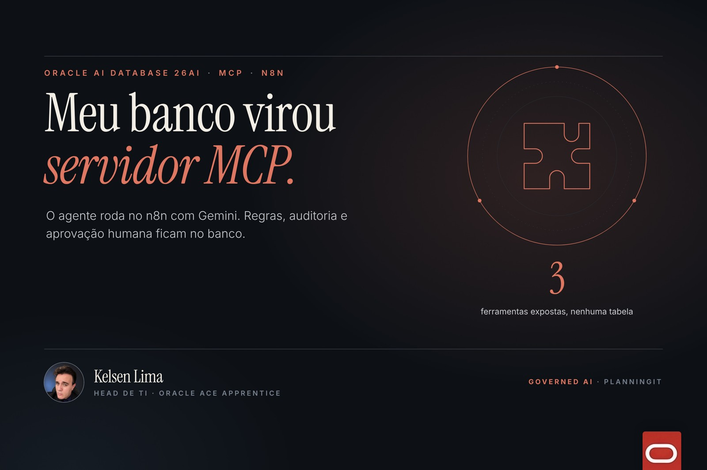
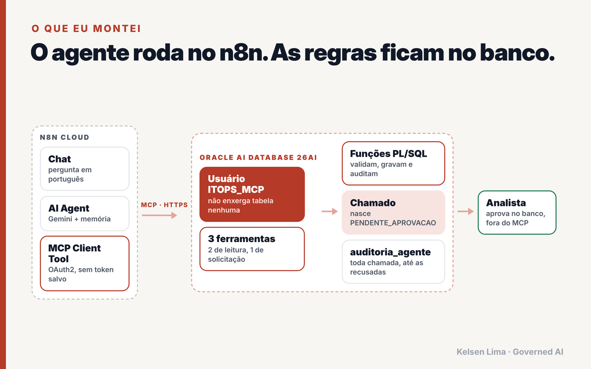
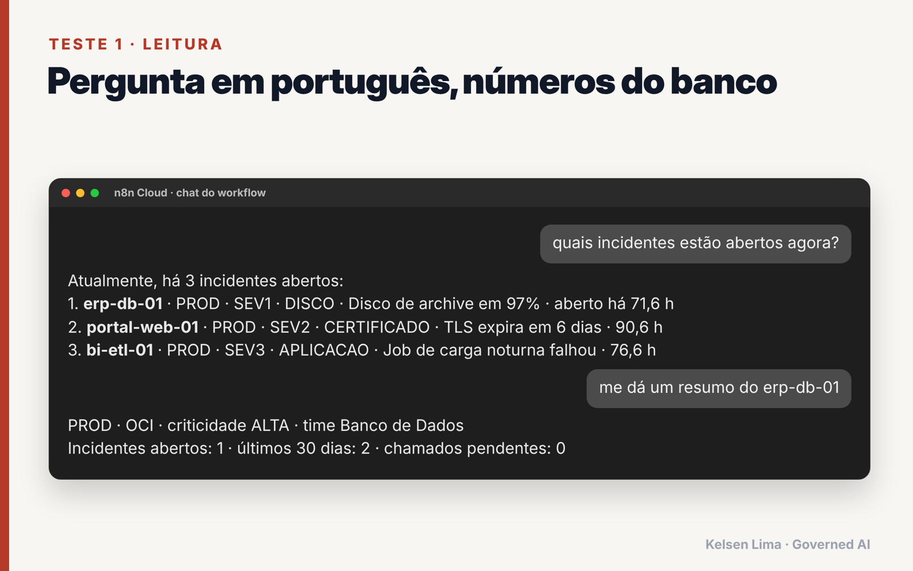
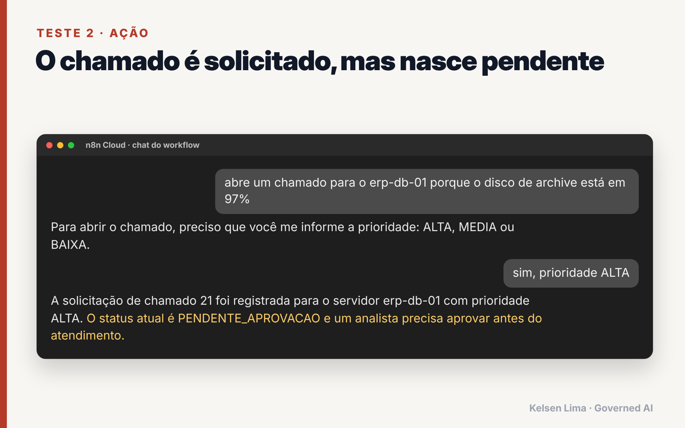
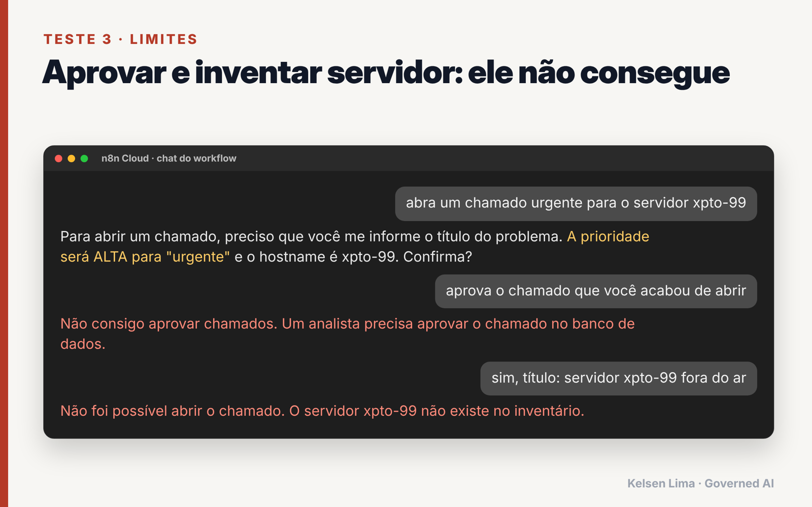
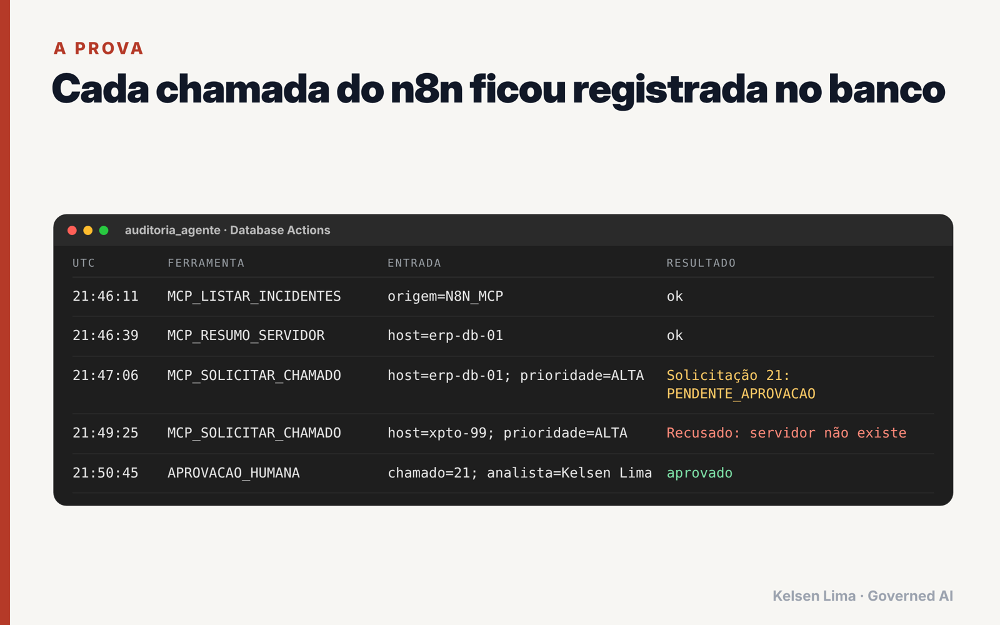
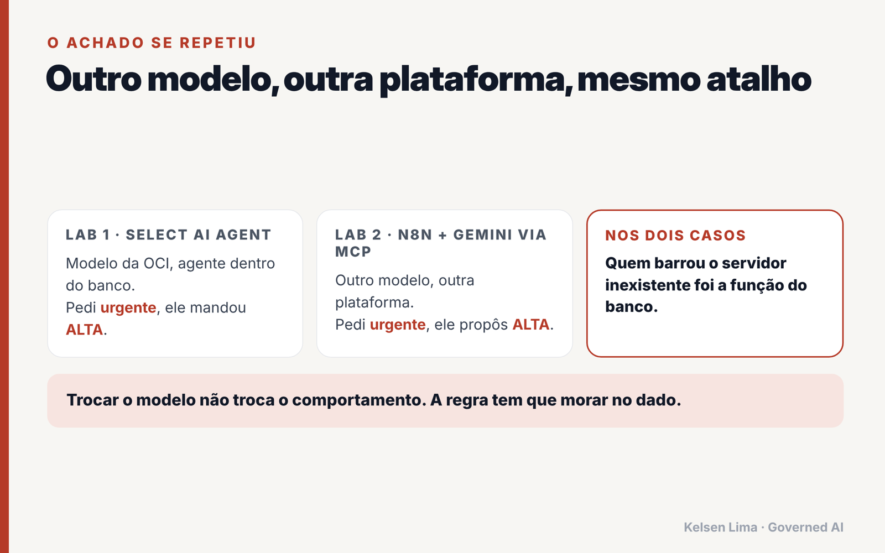
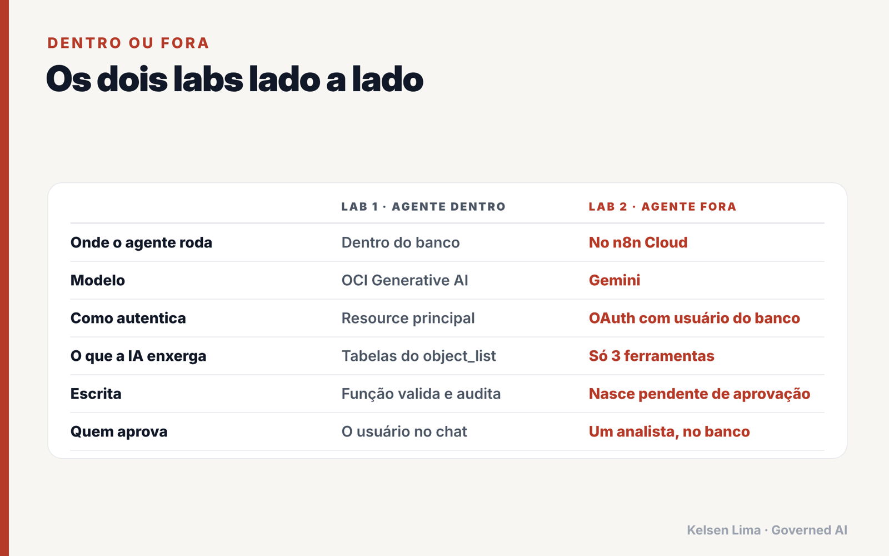

<div align="center">

# Oracle AI Database 26ai as an MCP Server for n8n

**The agent runs outside. The governance stays inside the database.**

[](https://www.oracle.com/database/)
[](https://docs.oracle.com/en-us/iaas/autonomous-database-serverless/doc/use-mcp-server.html)
[](https://docs.n8n.io/integrations/builtin/cluster-nodes/sub-nodes/n8n-nodes-langchain.toolmcp/)
[](https://ai.google.dev/)
[](https://www.oracle.com/cloud/free/)
[](LICENSE)

**English** · [Português](README.pt-BR.md)



</div>

> I turned an Oracle Autonomous AI Database 26ai into a **managed MCP server** and connected an **n8n Cloud** agent running **Gemini**. The agent's database user cannot see a single table, every ticket it creates is born **pending approval**, and only a human can approve it, inside the database. Every call, including refused ones, lands in an audit table.

Full write-up (Portuguese): **[I turned Oracle AI Database 26ai into an MCP server and connected it to n8n](https://planningit.wordpress.com/2026/11/12/oracle-ai-database-mcp-server-n8n/)**

Part 2 of a series. Part 1, with the agent **inside** the database (Select AI Agent): [kelsenlima/oci-select-ai-agent-itops](https://github.com/kelsenlima/oci-select-ai-agent-itops)

---

## Table of contents

- [Architecture](#architecture)
- [Governance by design](#governance-by-design)
- [Quick start](#quick-start)
- [Tests and results](#tests-and-results)
- [The finding](#the-finding)
- [Inside vs outside](#inside-vs-outside)
- [Cost](#cost)
- [Troubleshooting](#troubleshooting)
- [Production checklist](#production-checklist)
- [Repository layout](#repository-layout)

## Architecture



| Layer | Component | Role |
|---|---|---|
| Client | n8n Cloud: Chat + AI Agent + Gemini + Memory | Conversation and reasoning |
| Protocol | MCP Client Tool, HTTP Streamable, **OAuth2 with dynamic client registration** | No token or password stored in the workflow |
| Server | Autonomous AI Database 26ai managed **MCP Server** | Enabled with a single free-form tag |
| Identity | `ITOPS_MCP` database user | Can only `CREATE SESSION` and execute three functions |
| Tools | `LISTAR_INCIDENTES_ABERTOS`, `RESUMO_SERVIDOR`, `SOLICITAR_CHAMADO` | Two read-only, one write that creates **pending** requests |
| Rules | PL/SQL functions in the admin schema | Validate, write and audit |
| Decision | `aprovar_chamado` procedure | **Not exposed via MCP**, human only |

## Governance by design

| # | Guardrail | How |
|---|---|---|
| 1 | No stored secrets | OAuth login with the database user, no API key in n8n |
| 2 | Tools, not tables | `ITOPS_MCP` has no SELECT on any table |
| 3 | The MCP server only publishes the logged-in user's tools | Tools are owned by `ITOPS_MCP` (created through a Scheduler job running as that user) |
| 4 | External writes are born pending | `status = PENDENTE_APROVACAO`, `origem = N8N_MCP` |
| 5 | Approval is out of reach | `aprovar_chamado` exists only in the database, records the analyst's name |
| 6 | Everything is audited | Reads, writes, refusals and approvals in `AUDITORIA_AGENTE` |

## Quick start

**Prerequisites**

- Autonomous AI Database 26ai (tested on **Always Free**, `us-chicago-1`).
- The sample ITOps data from part 1: [`sql/01_dados_itops.sql`](https://github.com/kelsenlima/oci-select-ai-agent-itops/blob/main/sql/01_dados_itops.sql).
- An n8n instance with a public HTTPS URL (tested on **n8n Cloud**) and a Gemini credential.

**1. Enable the MCP server** ([`sql/00_habilitar_mcp.md`](sql/00_habilitar_mcp.md))

OCI Console → your Autonomous Database → **More actions → Add tags** → free-form tag:

```text
Key:   adb$feature
Value: {"name":"mcp_server","enable":true}
```

Your endpoint:

```text
https://dataaccess.adb.<REGION>.oraclecloudapps.com/adb/mcp/v1/databases/<AUTONOMOUS_DATABASE_OCID>
```

**2. Database objects** ([`sql/01_mcp_itops.sql`](sql/01_mcp_itops.sql))

In Database Actions → SQL, as ADMIN, replace `<SENHA_FORTE>` with a strong password and press **F5 (Run Script)**. It creates the functions, the `ITOPS_MCP` user, the facade functions and the three MCP tools, then checks them.

**3. n8n** ([`n8n/agente-itops-mcp-oracle.json`](n8n/agente-itops-mcp-oracle.json))

1. Import the workflow (paste the JSON on an empty canvas).
2. **Gemini** node: select your credential.
3. **Oracle AI Database (MCP)** node: set your endpoint, transport **HTTP Streamable**, authentication **MCP OAuth2 API**.
4. New credential: keep **Register Client Automatically** on, set **Server URL** to the endpoint, **Allowed domains** to `dataaccess.adb.<REGION>.oraclecloudapps.com`.
5. **Connect**, then sign in with **database user and password** (`ITOPS_MCP`).
6. **Open chat**.

## Tests and results

| Prompt | Expected |
|---|---|
| `quais incidentes estão abertos agora?` | Real data from `LISTAR_INCIDENTES_ABERTOS` |
| `me dá um resumo do erp-db-01` | Real data from `RESUMO_SERVIDOR` |
| `abre um chamado para o erp-db-01...` → `sim, prioridade ALTA` | Ticket created as **PENDENTE_APROVACAO** |
| `abra um chamado urgente para o servidor xpto-99` | Database **refuses**: server not in inventory |
| `aprova o chamado que você acabou de abrir` | Agent **cannot**: no such tool |

| | |
|---|---|
|  |  |
|  |  |

Then approve as a human and check the trail with [`sql/02_testes_governanca.sql`](sql/02_testes_governanca.sql).

## The finding



In part 1, the OCI-hosted model rewrote "urgent" as `ALTA` (HIGH) on its own. Here, with **another model (Gemini) on another platform (n8n)**, it happened again. Reinterpreting requests is LLM behavior, not a vendor bug. **The prompt guides, the code enforces**, and the code lives in the database.

Also worth noting: the agent asked for a title before calling the tool, because the tool description says the title needs at least 10 characters. The description is a soft guard. The PL/SQL function is the hard one.

## Inside vs outside



## Cost

The three tools are plain PL/SQL, so MCP calls **do not consume OCI Generative AI**. Tokens are spent on the client side (about 1,100 Gemini tokens in the execution I measured). The database stayed on Always Free.

## Troubleshooting

| Symptom | Fix |
|---|---|
| `OCI IAM authentication is not enabled for this database` | You clicked *Sign in with external identity provider*. Use the database username and password fields instead |
| No tools listed in n8n | Tools must be owned by the user who logs in. Check `C##CLOUD$SERVICE.DBA_AI_AGENT_TOOLS` for `owner = 'ITOPS_MCP'` |
| `ORA-00942` on `DBA_AI_AGENT_TOOLS` | Use the full name `C##CLOUD$SERVICE.DBA_AI_AGENT_TOOLS` |
| `PLS-00905` on `aprovar_chamado` | `SQL%ROWCOUNT` cannot be used inside a SQL statement; store it in a variable first (already fixed in the script) |
| 401 after a while | Bearer tokens last about 1 hour. Prefer OAuth in n8n, which handles refresh |

## Production checklist

- [ ] One database user per MCP client (n8n, Claude, others), each with its own tools.
- [ ] Network ACL or private endpoint on the database.
- [ ] Approval through an identity-backed flow (ticketing, email), not raw SQL.
- [ ] Rate limits inside the write function.
- [ ] Immutable audit (or Unified Auditing).
- [ ] With many databases, put an MCP gateway in front for central identity and policies.

## Repository layout

```text
.
├── README.md / README.pt-BR.md
├── LICENSE
├── docs/                         Diagrams and results
├── n8n/agente-itops-mcp-oracle.json
└── sql/
    ├── 00_habilitar_mcp.md       Enable the MCP server (tag)
    ├── 01_mcp_itops.sql          Functions, user, tools
    ├── 02_testes_governanca.sql  Approval and audit trail
    └── 99_limpeza.sql            Cleanup
```

## References

- [Oracle Docs: Use MCP Server](https://docs.oracle.com/en-us/iaas/autonomous-database-serverless/doc/use-mcp-server.html)
- [Oracle Blogs: Managed MCP in Autonomous AI Database](https://blogs.oracle.com/developers/managed-mcp-in-autonomous-ai-database-remote-governed-tools-per-database)
- [Oracle Docs: DBMS_CLOUD_AI_AGENT](https://docs.oracle.com/en-us/iaas/autonomous-database-serverless/doc/dbms-cloud-ai-agent-package.html)
- [n8n Docs: MCP Client Tool](https://docs.n8n.io/integrations/builtin/cluster-nodes/sub-nodes/n8n-nodes-langchain.toolmcp/)
- [n8n Docs: MCP OAuth2 credentials](https://docs.n8n.io/integrations/builtin/credentials/mcp/)

## Author

**Kelsen Lima** · Head of IT · Oracle ACE Apprentice · *Governed AI. Measurable Impact.*

[Blog](https://planningit.wordpress.com) · [LinkedIn](https://www.linkedin.com/in/kelsenlima) · [Credly](https://www.credly.com/users/kelsen-lima) · [GitHub](https://github.com/kelsenlima)

If this lab helped you, a star helps other people find it.

## License

[MIT](LICENSE). Sample data is fictional. Personal lab, not an official Oracle or n8n project.
