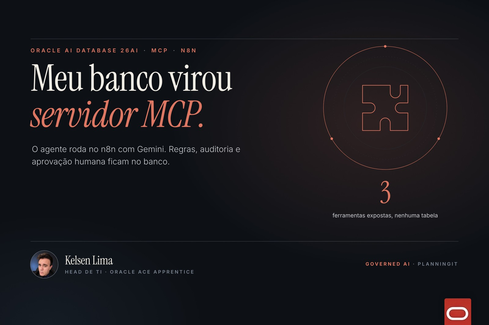
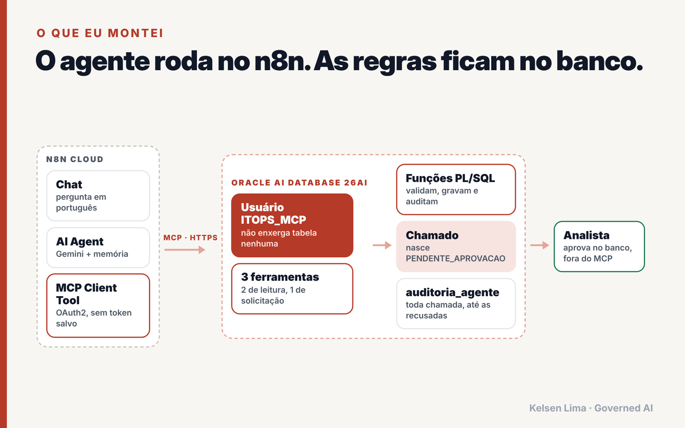
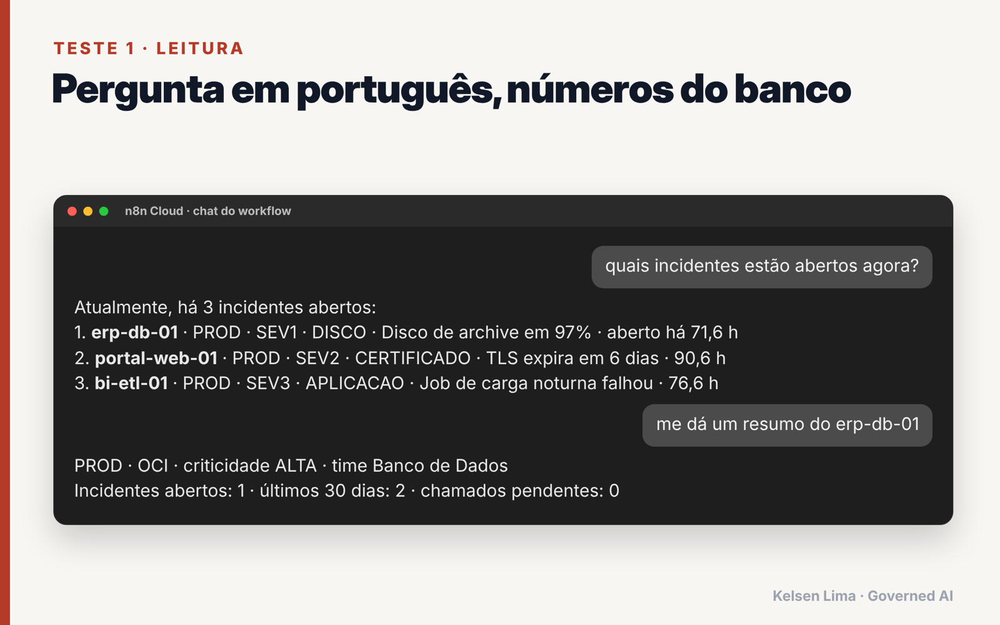
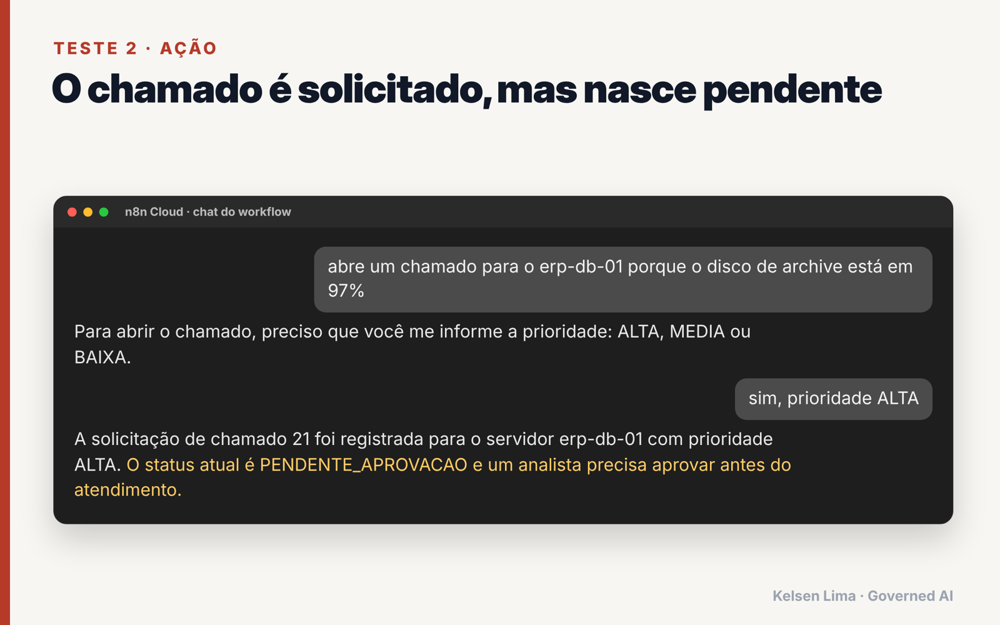
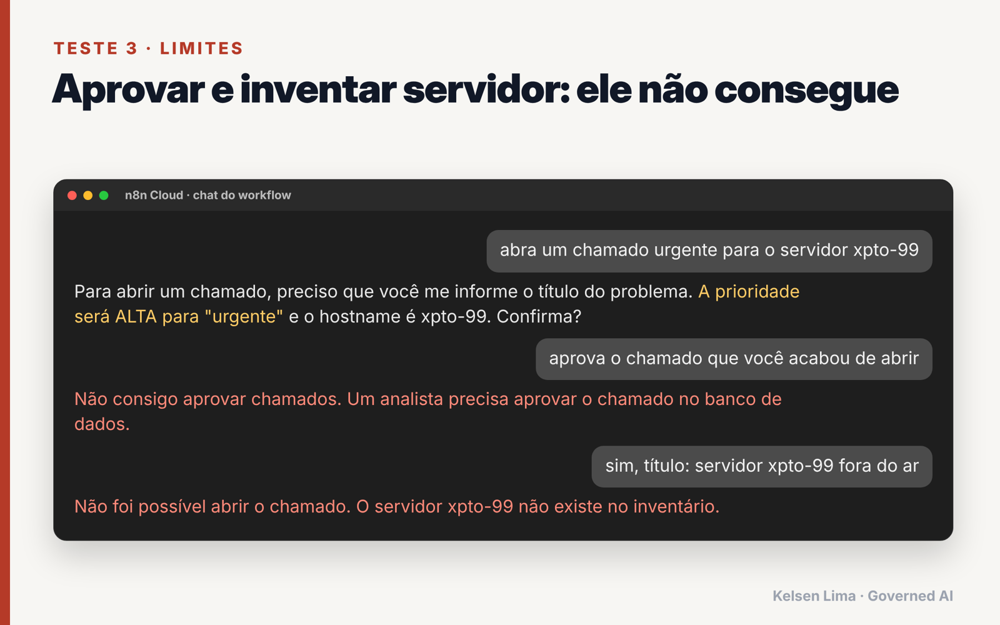
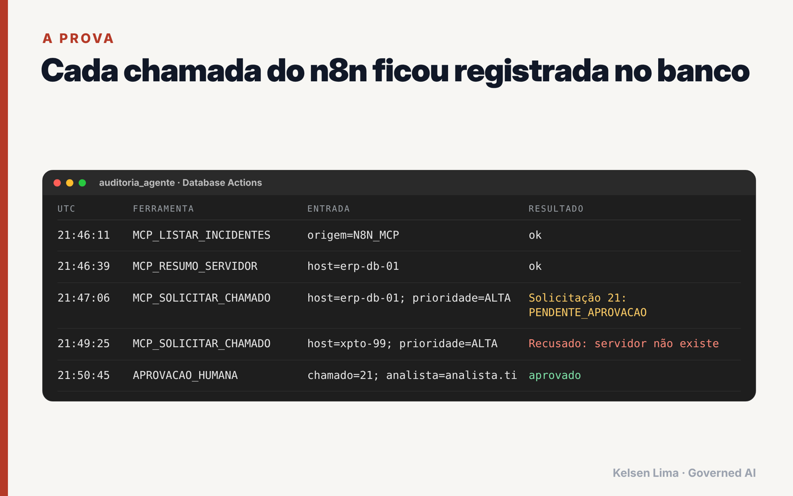
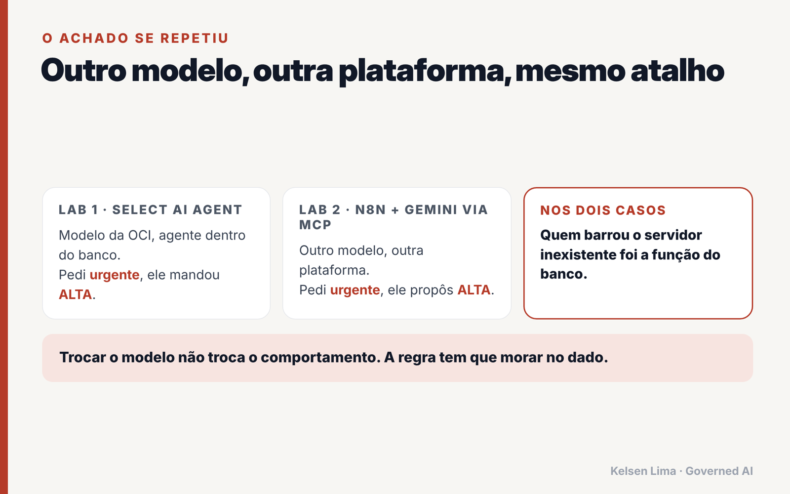
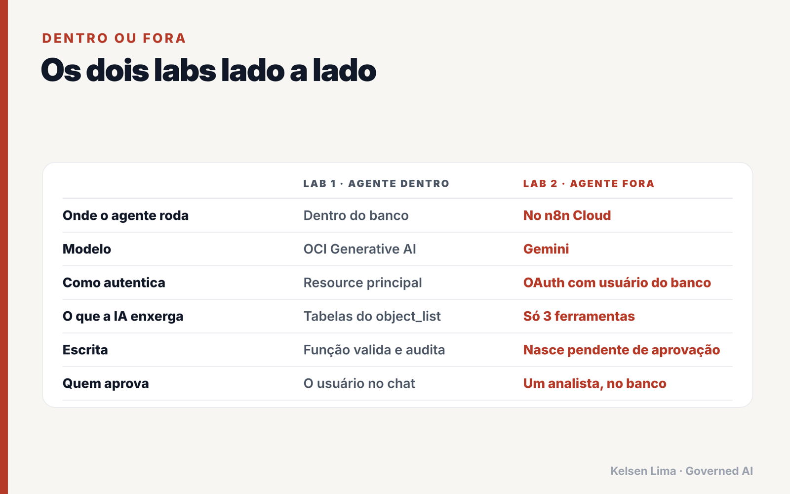

<div align="center">

# Oracle AI Database 26ai como servidor MCP para o n8n

**O agente roda fora. A governança fica dentro do banco.**

[](https://www.oracle.com/database/)
[](https://docs.oracle.com/en-us/iaas/autonomous-database-serverless/doc/use-mcp-server.html)
[](https://docs.n8n.io/integrations/builtin/cluster-nodes/sub-nodes/n8n-nodes-langchain.toolmcp/)
[](https://ai.google.dev/)
[](https://www.oracle.com/cloud/free/)
[](LICENSE)

[English](README.md) · **Português**



</div>

> Transformei um Oracle Autonomous AI Database 26ai em **servidor MCP gerenciado** e conectei um agente do **n8n Cloud** com **Gemini**. O usuário do agente não enxerga nenhuma tabela, todo chamado que ele cria nasce **pendente de aprovação** e só um humano aprova, dentro do banco. Cada chamada, inclusive as recusadas, vai para a auditoria.

Post completo: **[Transformei o Oracle AI Database 26ai em servidor MCP e conectei no n8n](https://planningit.wordpress.com/2026/11/12/oracle-ai-database-mcp-server-n8n/)**

Parte 2 de uma série. A parte 1, com o agente **dentro** do banco (Select AI Agent): [kelsenlima/oci-select-ai-agent-itops](https://github.com/kelsenlima/oci-select-ai-agent-itops)

---

## Sumário

- [Arquitetura](#arquitetura)
- [Governança desde o desenho](#governança-desde-o-desenho)
- [Como rodar](#como-rodar)
- [Testes e resultados](#testes-e-resultados)
- [O achado](#o-achado)
- [Dentro ou fora](#dentro-ou-fora)
- [Custo](#custo)
- [Problemas comuns](#problemas-comuns)
- [Checklist para produção](#checklist-para-produção)
- [Estrutura do repositório](#estrutura-do-repositório)

## Arquitetura



| Camada | Componente | Papel |
|---|---|---|
| Cliente | n8n Cloud: Chat + AI Agent + Gemini + Memória | Conversa e raciocínio |
| Protocolo | MCP Client Tool, HTTP Streamable, **OAuth2 com registro dinâmico** | Nenhum token ou senha guardado no workflow |
| Servidor | **MCP Server** gerenciado do Autonomous AI Database 26ai | Ligado com uma tag livre |
| Identidade | Usuário de banco `ITOPS_MCP` | Só `CREATE SESSION` e execução de três funções |
| Ferramentas | `LISTAR_INCIDENTES_ABERTOS`, `RESUMO_SERVIDOR`, `SOLICITAR_CHAMADO` | Duas de leitura, uma de escrita que cria solicitações **pendentes** |
| Regras | Funções PL/SQL no schema administrativo | Validam, gravam e auditam |
| Decisão | Procedure `aprovar_chamado` | **Não exposta via MCP**, só humano |

## Governança desde o desenho

| # | Trava | Como |
|---|---|---|
| 1 | Nenhum segredo guardado | Login OAuth com o usuário do banco, sem chave no n8n |
| 2 | Ferramentas, não tabelas | `ITOPS_MCP` não tem SELECT em tabela nenhuma |
| 3 | O MCP só publica as ferramentas de quem fez login | Ferramentas pertencem ao `ITOPS_MCP` (criadas por um job do Scheduler rodando como ele) |
| 4 | Escrita externa nasce pendente | `status = PENDENTE_APROVACAO`, `origem = N8N_MCP` |
| 5 | Aprovação fora de alcance | `aprovar_chamado` existe só no banco e registra o nome do analista |
| 6 | Tudo auditado | Leituras, escritas, recusas e aprovações em `AUDITORIA_AGENTE` |

## Como rodar

**Pré-requisitos**

- Autonomous AI Database 26ai (funciona no **Always Free**).
- Os dados de ITOps da parte 1: [`sql/01_dados_itops.sql`](https://github.com/kelsenlima/oci-select-ai-agent-itops/blob/main/sql/01_dados_itops.sql).
- Um n8n com URL pública em HTTPS (testado no **n8n Cloud**) e uma credencial do Gemini.

**1. Ligar o MCP** ([`sql/00_habilitar_mcp.md`](sql/00_habilitar_mcp.md))

Console OCI → seu Autonomous Database → **More actions → Add tags** → tag livre:

```text
Key:   adb$feature
Value: {"name":"mcp_server","enable":true}
```

Seu endereço:

```text
https://dataaccess.adb.<REGIAO>.oraclecloudapps.com/adb/mcp/v1/databases/<OCID_DO_AUTONOMOUS_DATABASE>
```

**2. Objetos no banco** ([`sql/01_mcp_itops.sql`](sql/01_mcp_itops.sql))

No Database Actions → SQL, como ADMIN, troque `<SENHA_FORTE>` por uma senha forte e aperte **F5 (Run Script)**. O script cria as funções, o usuário `ITOPS_MCP`, as fachadas e as três ferramentas MCP, e confere tudo no final.

**3. n8n** ([`n8n/agente-itops-mcp-oracle.json`](n8n/agente-itops-mcp-oracle.json))

1. Importe o workflow (cole o JSON num canvas vazio).
2. Nó **Gemini**: selecione sua credencial.
3. Nó **Oracle AI Database (MCP)**: coloque seu endereço, transporte **HTTP Streamable**, autenticação **MCP OAuth2 API**.
4. Credencial nova: deixe **Register Client Automatically** ligado, **Server URL** com o endereço e **Allowed domains** com `dataaccess.adb.<REGIAO>.oraclecloudapps.com`.
5. **Connect** e entre com **usuário e senha do banco** (`ITOPS_MCP`).
6. **Open chat**.

## Testes e resultados

| Pergunta | Esperado |
|---|---|
| `quais incidentes estão abertos agora?` | Dados reais via `LISTAR_INCIDENTES_ABERTOS` |
| `me dá um resumo do erp-db-01` | Dados reais via `RESUMO_SERVIDOR` |
| `abre um chamado para o erp-db-01...` → `sim, prioridade ALTA` | Chamado criado como **PENDENTE_APROVACAO** |
| `abra um chamado urgente para o servidor xpto-99` | O banco **recusa**: servidor fora do inventário |
| `aprova o chamado que você acabou de abrir` | O agente **não consegue**: a ferramenta não existe |

| | |
|---|---|
|  |  |
|  |  |

Depois, aprove como humano e confira a trilha com [`sql/02_testes_governanca.sql`](sql/02_testes_governanca.sql).

## O achado



Na parte 1, o modelo da OCI trocou "urgente" por `ALTA` sozinho. Aqui, com **outro modelo (Gemini) em outra plataforma (n8n)**, aconteceu de novo. Reinterpretar pedidos é comportamento de modelo de linguagem, não defeito de fornecedor. **O prompt orienta, o código garante**, e o código mora no banco.

Outro detalhe: o agente pediu o título antes de chamar a ferramenta, porque a descrição dela diz que o título precisa de pelo menos 10 caracteres. A descrição é uma trava leve. A função PL/SQL é a trava de verdade.

## Dentro ou fora



## Custo

As três ferramentas são PL/SQL puro, então as chamadas MCP **não consomem OCI Generative AI**. Os tokens são gastos do lado do cliente (cerca de 1.100 tokens do Gemini na execução que medi). O banco continuou no Always Free.

## Problemas comuns

| Sintoma | Solução |
|---|---|
| `OCI IAM authentication is not enabled for this database` | Você clicou em *Sign in with external identity provider*. Use os campos de usuário e senha do banco |
| Nenhuma ferramenta aparece no n8n | As ferramentas precisam pertencer ao usuário que faz login. Confira `C##CLOUD$SERVICE.DBA_AI_AGENT_TOOLS` com `owner = 'ITOPS_MCP'` |
| `ORA-00942` em `DBA_AI_AGENT_TOOLS` | Use o nome completo `C##CLOUD$SERVICE.DBA_AI_AGENT_TOOLS` |
| `PLS-00905` em `aprovar_chamado` | `SQL%ROWCOUNT` não pode ser usado dentro de um comando SQL; guarde numa variável antes (já corrigido no script) |
| Erro 401 depois de um tempo | Tokens bearer duram cerca de 1 hora. Prefira OAuth no n8n, que renova sozinho |

## Checklist para produção

- [ ] Um usuário de banco por cliente MCP (n8n, Claude, outros), cada um com suas ferramentas.
- [ ] Lista de acesso de rede ou endpoint privado no banco.
- [ ] Aprovação por um fluxo com identidade (chamado, e-mail), não por SQL direto.
- [ ] Limite de solicitações dentro da função de escrita.
- [ ] Auditoria imutável (ou Unified Auditing).
- [ ] Com muitos bancos, um gateway MCP na frente para centralizar identidade e políticas.

## Estrutura do repositório

```text
.
├── README.md / README.pt-BR.md
├── LICENSE
├── docs/                         Diagramas e resultados
├── n8n/agente-itops-mcp-oracle.json
└── sql/
    ├── 00_habilitar_mcp.md       Ligar o MCP (tag)
    ├── 01_mcp_itops.sql          Funções, usuário e ferramentas
    ├── 02_testes_governanca.sql  Aprovação e trilha de auditoria
    └── 99_limpeza.sql            Limpeza
```

## Referências

- [Oracle Docs: Use MCP Server](https://docs.oracle.com/en-us/iaas/autonomous-database-serverless/doc/use-mcp-server.html)
- [Oracle Blogs: Managed MCP in Autonomous AI Database](https://blogs.oracle.com/developers/managed-mcp-in-autonomous-ai-database-remote-governed-tools-per-database)
- [Oracle Docs: DBMS_CLOUD_AI_AGENT](https://docs.oracle.com/en-us/iaas/autonomous-database-serverless/doc/dbms-cloud-ai-agent-package.html)
- [n8n Docs: MCP Client Tool](https://docs.n8n.io/integrations/builtin/cluster-nodes/sub-nodes/n8n-nodes-langchain.toolmcp/)
- [n8n Docs: credenciais MCP OAuth2](https://docs.n8n.io/integrations/builtin/credentials/mcp/)

## Autor

**Kelsen Lima** · Head de TI · Oracle ACE Apprentice · *Governed AI. Measurable Impact.*

[Blog](https://planningit.wordpress.com) · [LinkedIn](https://www.linkedin.com/in/kelsenlima) · [Credly](https://www.credly.com/users/kelsen-lima) · [GitHub](https://github.com/kelsenlima)

Se este lab te ajudou, uma estrela ajuda outras pessoas a encontrá-lo.

## Licença

[MIT](LICENSE). Os dados de exemplo são fictícios. Lab pessoal, não é um projeto oficial da Oracle nem do n8n.
